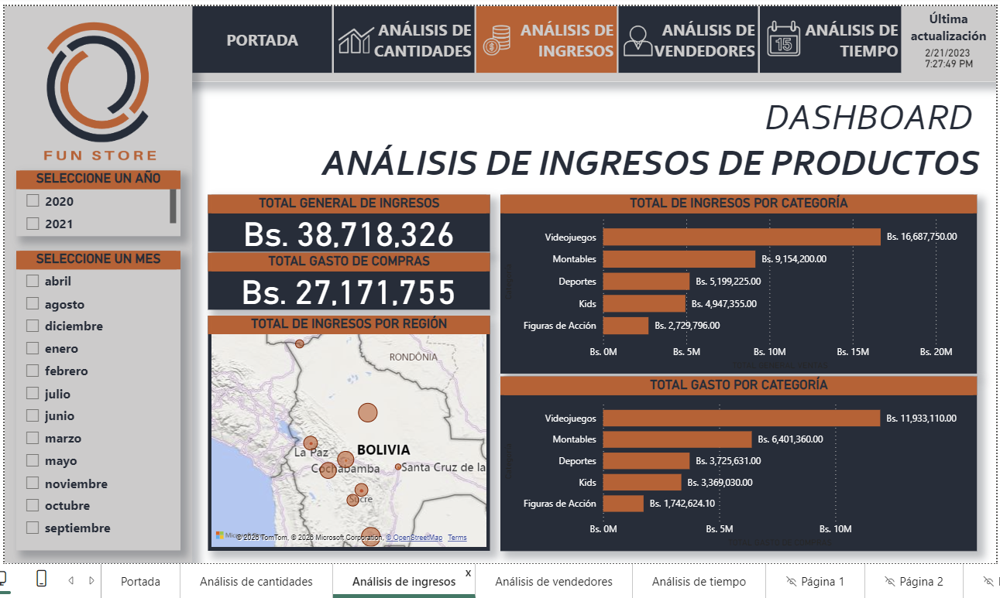

# Proyectos de Power BI

Reportes desarrollados durante un curso de Power BI. La institución proporcionó los datos de partida; realicé las etapas de preparación, modelado, cálculos, visualización y diseño hasta el resultado final.

## Fun Store: ventas, compras e inventario

Dashboard con vistas de cantidades, ingresos, vendedores y evolución temporal para datos de 2020–2021. El caso presenta capturas, método, indicadores y límites de interpretación.

[Leer el caso Fun Store](cases/fun-store/README.md) · [Abrir el archivo Power BI](LAB%20DIA%2012/DIA%2012-LAB%202-PAOLA%20TUCUMAN.pbix)

## Otros ejercicios

La carpeta [LAB DIA 8](LAB%20DIA%208/) conserva otro laboratorio del curso. El proyecto Fun Store es el caso principal de este repositorio.

