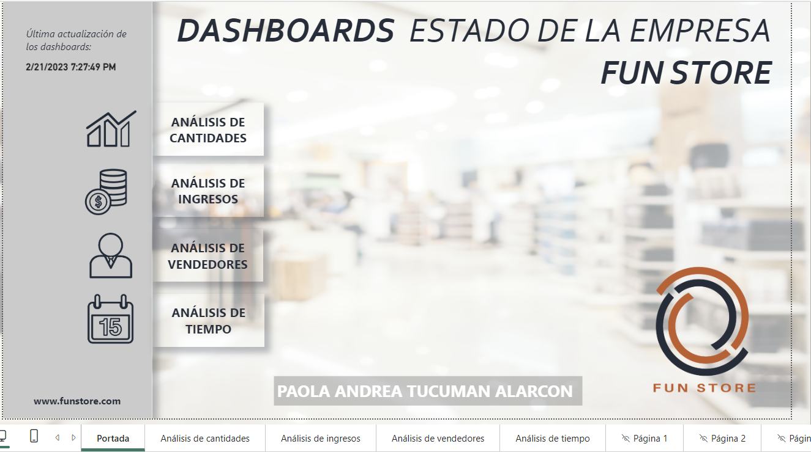

# Fun Store: dashboard de ventas, compras e inventario

Proyecto de Power BI realizado durante un curso con un conjunto de datos proporcionado por la institución. A partir de esos datos, preparé el modelo, construí los cálculos y las visualizaciones, diseñé la navegación y terminé el dashboard. Las capturas permiten recorrer el resultado sin instalar Power BI Desktop.

## Pregunta del proyecto

¿Cómo se distribuyen las ventas y las unidades por categoría, región, vendedor y periodo, y qué indicadores de compras e inventario permite vigilar el reporte?

## Datos y construcción

El curso proporcionó un libro de Excel con tablas de categorías, productos, vendedores, regiones, inventario, compras y ventas. Las tres tablas de movimientos tienen 7.236 filas cada una. El periodo de ventas mostrado es **2020–2021**. El reporte tiene portada y cuatro vistas: cantidades, ingresos, vendedores y tiempo, con filtros por año, mes y categoría según la página.

El valor de ventas se obtiene sumando `Cantidad × PrecioUnitario` en la tabla de ventas. El gasto de compras se obtiene sumando `Cantidad × PrecioCompra` en la tabla de compras. La diferencia entre ambos **no se presenta como beneficio**: faltan otros costos y las tablas no necesariamente relacionan las mismas unidades.

## Indicadores

Totales del libro de datos del curso, con el reporte sin filtros activos:

| Indicador | Valor |
| --- | ---: |
| Unidades vendidas | 32.677 |
| Unidades compradas | 32.482 |
| Inventario sumado en el archivo | 3.586 |
| Ventas 2020 | Bs. 19.773.993 |
| Ventas 2021 | Bs. 18.944.333 |
| Ventas 2020–2021 | Bs. 38.718.326 |
| Gasto de compras en el archivo | Bs. 27.171.755,10 |

Las ventas de 2021 fueron **Bs. 829.660 menores** que las de 2020, una disminución aproximada de **4,2%**. Es una comparación descriptiva de los datos del ejercicio; no establece por qué ocurrió el cambio.

## Vistas del reporte

| Vista | Qué permite examinar |
| --- | --- |
| [Cantidades](images/cantidades.png) | Unidades vendidas, compradas e inventario, con desglose por categoría y región. |
| [Ingresos](images/ingresos.png) | Ventas y gasto de compras por categoría y región. |
| [Vendedores](images/vendedores.png) | Comparación de ventas por vendedor y filtros de periodo y categoría. |
| [Tiempo](images/tiempo.png) | Comparación anual y tablas mensuales de ventas. |

## Mi contribución

La institución entregó los datos de partida. Realicé todas las etapas posteriores hasta el reporte final: preparación de datos, relaciones y modelo, medidas e indicadores, selección y configuración de visualizaciones, filtros, navegación, diseño de páginas y comprobación del resultado.

## Límites

Las capturas muestran la interfaz de Power BI. La fecha visible de actualización es de 2023; el caso presenta datos históricos de 2020–2021. Las cifras describen el conjunto entregado durante el curso y no acreditan resultados comerciales de una empresa real.

## Archivo del proyecto

El [archivo editable `.pbix`](https://github.com/paolaTucuman/powerbiProjects/blob/main/LAB%20DIA%2012/DIA%2012-LAB%202-PAOLA%20TUCUMAN.pbix) permite explorar el reporte completo en Power BI Desktop.

